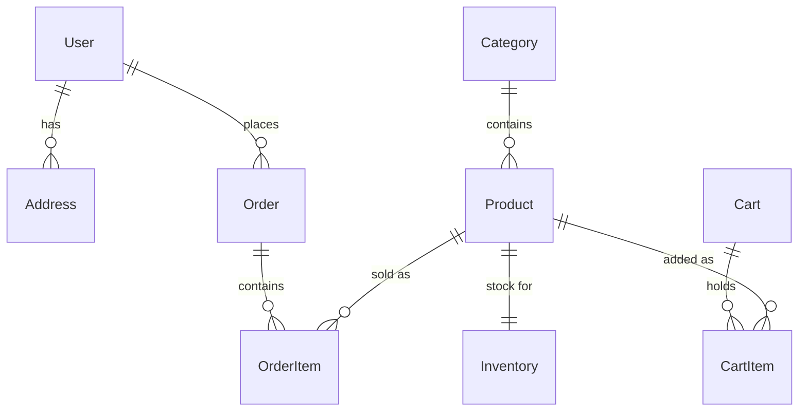

# ShopAPI

A backend for a simple online shop, built with **Django** and **Django REST Framework** as a class project for learning Django.

The project covers the main parts of an e-commerce backend: user accounts and addresses, a product catalog with inventory, shopping carts, and orders.

> **Status:** In progress. The data models are done. The API endpoints (serializers, views, URLs) and admin registration are still to come.

---

## How to Use This Repo

This is the **reference version** of the project we build together in class. Use it to compare against your own code and make sure you're up to date.

- Each lesson's work is saved as one or more commits. Run `git log --oneline` to see them.
- To see exactly what changed in a lesson, run `git show <commit-hash>`.
- To see the whole project as it was at a given point, run `git checkout <commit-hash>`. Run `git checkout main` to come back to the latest version.
- If your code differs from this repo, go with the version here, then ask in class if anything isn't clear.

> The database settings in `shopapi/settings.py` are placeholders on purpose. Fill in your own PostgreSQL details (see [Getting Started](#getting-started)).

---

## Tech Stack

| Tool | Purpose |
| --- | --- |
| Python 3.14 | Language |
| Django 6.1 | Web framework and ORM |
| Django REST Framework 3.18 | Building the REST API |
| PostgreSQL (`psycopg2-binary`) | Database |
| [uv](https://docs.astral.sh/uv/) | Dependency and virtual environment management |

---

## Project Structure

```
shopapi/
├── manage.py            # Django command-line utility
├── pyproject.toml       # Project metadata and dependencies
├── uv.lock              # Locked dependency versions
├── shopapi/             # Project configuration (settings, root URLs, WSGI/ASGI)
├── common/              # Shared code, such as the TimestampedModel base class
├── accounts/            # Custom User model and Address
├── catalog/             # Category, Product, Inventory, Cart, CartItem
└── orders/              # Order and OrderItem
```

---

## Data Models

### `common`
- **TimestampedModel**: an abstract base model that adds `created_at` and `updated_at` to any model that inherits from it.

### `accounts`
- **User**: a custom user model that extends `AbstractUser`. Users log in with their **email** (`USERNAME_FIELD = "email"`) and also have a `phone` number. It is set as `AUTH_USER_MODEL` in settings.
- **Address**: a user's delivery address, labelled home, work or other. A database constraint makes sure each user has **only one default address**.

### `catalog`
- **Category**: a product category with a unique `name` and `slug`.
- **Product**: an item for sale with a title, description, price, unique SKU and an `is_active` flag. Deleting a category that still has products is blocked (`on_delete=PROTECT`).
- **Inventory**: a one-to-one stock record for each product. It tracks `quantity_on_hand` and `quantity_reserved`, and a check constraint keeps reserved stock from exceeding stock on hand. It has two helper properties, `available` and `is_low_stock`.
- **Cart**: a shopping cart identified by a UUID, so anonymous visitors can have one too.
- **CartItem**: a product and quantity in a cart. Each product appears at most once per cart, and `line_total` gives price × quantity.

### `orders`
- **Order**: a user's order with a status (`pending`, `paid`, `shipped`, `cancelled`), a total, and a JSON copy of the shipping address.
- **OrderItem**: a line in an order. It stores the product's **title and price at the time of purchase**, so later changes to the product don't alter past orders.

### Relationships



---

## Getting Started

### 1. Prerequisites
- Python 3.14
- [uv](https://docs.astral.sh/uv/getting-started/installation/)
- A running PostgreSQL server

### 2. Clone the repository and install dependencies

```bash
git clone <repository-url>
cd shopapi
uv sync
```

`uv sync` creates a `.venv` folder and installs everything listed in `pyproject.toml`.

### 3. Create the database

```bash
createdb shopapi
```

### 4. Configure the database connection

Open `shopapi/settings.py` and replace the placeholder values in `DATABASES` with your own:

```python
DATABASES = {
    'default': {
        'ENGINE': 'django.db.backends.postgresql',
        'NAME': 'shopapi',
        'USER': 'postgres',
        'PASSWORD': 'your-password',
        'HOST': 'localhost',
        'PORT': '5432',
    }
}
```

> Don't commit real passwords. A good next step is to read these values from environment variables.

### 5. Apply migrations and create an admin user

```bash
uv run python manage.py migrate
uv run python manage.py createsuperuser
```

### 6. Run the development server

```bash
uv run python manage.py runserver
```

The server runs at http://127.0.0.1:8000/ and the admin site at http://127.0.0.1:8000/admin/.

---

## Useful Commands

| Command | What it does |
| --- | --- |
| `uv run python manage.py makemigrations` | Create migration files after you change models |
| `uv run python manage.py migrate` | Apply migrations to the database |
| `uv run python manage.py shell` | Open a Python shell with Django loaded |
| `uv run python manage.py test` | Run the tests |
| `uv run python manage.py createsuperuser` | Create an admin account |

---

## Django Concepts Covered

- Splitting a project into multiple **apps** (`accounts`, `catalog`, `orders`, `common`)
- Writing a **custom user model** with `AbstractUser` and logging in by email
- Sharing fields through an **abstract base model**
- Relationships: `ForeignKey`, `OneToOneField` and `related_name`
- `on_delete` choices: `CASCADE` and `PROTECT`
- Field **choices** with `TextChoices`
- Database **constraints**: `UniqueConstraint` (including conditional ones) and `CheckConstraint`
- Database **indexes** and default `ordering`
- Field **validators** such as `MinValueValidator`
- Model **properties** for computed values (`line_total`, `available`)
- Using a **UUID primary key**
- Connecting Django to **PostgreSQL**

---

## Roadmap

- [x] Project setup
- [x] Models for users, addresses, catalog, cart and orders
- [ ] Register models in the Django admin
- [ ] DRF serializers
- [ ] API views and viewsets
- [ ] URL routing for the API
- [ ] Authentication (e.g. token or JWT)
- [ ] Checkout flow: turn a cart into an order and reserve inventory
- [ ] Tests
- [ ] Move secrets into environment variables
# shopapi
